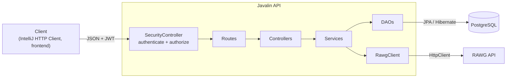
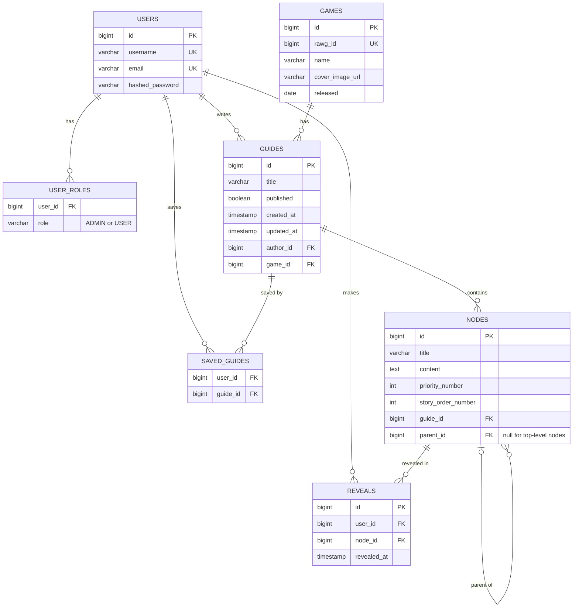

# Build Guide API

## Project Overview

**Vision:** Build Guide lets players follow a game guide without spoilers. Guides are trees of sections that stay hidden until the reader reveals them, and the same guide can be read in story order or as the fastest route.

- **Portfolio:** [](https://mikkelmattern.github.io/BlowfishRepo/)
- **Deployed version:** Not deployed. The project runs on `localhost:7070` (see [Running the project](#running-the-project)).

## Architecture

### High-level description

Build Guide is a backend-only REST API. Clients send HTTP requests with JSON bodies to a Javalin server, which checks the JWT, runs the business rules and stores data in PostgreSQL through Hibernate. Game data (names, release dates, cover images) is imported from the external [RAWG](https://rawg.io/apidocs) API.



### Application structure

The code is split into layers, each in its own package under `mikkelmattern`:

| Package | Responsibility |
|---|---|
| `routes` | Maps each URL and HTTP method to a controller method, and the roles it requires |
| `controller` | Reads path parameters, query parameters and the JSON body from the Javalin `Context`, calls a service and writes the response |
| `services` | Business rules: who may see or change what, validation, cascading reveals |
| `DAOs` | Database access with `EntityManager` and JPQL. No business rules |
| `entities` | JPA entities mapped to the database tables |
| `DTOs`, `records` | What is sent to and from the API, so entities are never exposed directly |
| `mappers` | Converts between entities and DTOs, and builds the node tree |
| `security` | JWT creation and verification, login, access checks |
| `clients` | `RawgClient`, which calls the RAWG API |
| `config` | Javalin and Hibernate setup |
| `utils` | `TreeUtil` for subtrees, and reading `config.properties` |

### Important architectural decisions

- **A self-referencing node tree.** A `Node` has a `parent` and `children`, so a guide can follow any game's own structure at any depth, instead of fixed levels like act → location → section.
- **Subtrees in memory.** Revealing, hiding, moving and deleting all work on a node's whole subtree. `TreeUtil.collectSubtreeIds` loads the guide's nodes in one query and walks the tree in memory, instead of one query per level. It's also protected against loops in the data.
- **Content is hidden on the server.** A node's `content` is sent as `null` until the reader has revealed it, so spoilers never reach the client before the reader asks for them.
- **Two orders, one tree.** Story order and fastest route use the same data, sorted by `storyOrderNumber` or `priorityNumber`. Switching modes never changes what has been revealed.
- **Saved and guest reveals.** Logged-in users' reveals are saved in the database. Guests' reveals are kept in the session, so the site works without an account.
- **Stateless authentication with JWT.** The server keeps no login sessions. Every request carries a signed token with the user's id and roles.
- **Drafts are hidden with 404.** Unpublished guides give 404 instead of 403 to other users, so they can't tell that a draft exists.
- **Rules in the services.** The DAOs only read and write data. All access rules live in the services, which keeps them in one place and makes the DAOs reusable.
- **Shallow nested URLs.** A node is created under its guide (`POST /guides/{guideId}/nodes`), but updated and deleted by its own id (`/nodes/{id}`), since node ids are unique.

### Technologies

| Area | Technology |
|---|---|
| Language | Java 17 |
| Web framework | Javalin 7 |
| Persistence | JPA with Hibernate 7, PostgreSQL, HikariCP connection pool |
| JSON | Jackson |
| Security | JWT (signed with HMAC-SHA256), BCrypt password hashing |
| External API | RAWG, called with Java's `HttpClient` |
| Boilerplate | Lombok |
| Testing | JUnit, IntelliJ HTTP Client |
| Build | Maven |

## Data Model

### ERD



### Entities and relationships

- **User:** a person with a unique username and email, and a BCrypt-hashed password. Roles are stored in `user_roles` with `@ElementCollection` and `@Enumerated(EnumType.STRING)`.
- **Game:** a game imported from RAWG. `rawgId` is unique, so the same game can't be imported twice.
- **Guide:** a guide for a game, written by one user (`@ManyToOne author`). It starts as a draft (`published = false`). `createdAt` and `updatedAt` are set automatically with `@PrePersist` and `@PreUpdate`.
- **Node:** a section in a guide. It belongs to one guide (`@ManyToOne guide`) and has an optional parent node (`@ManyToOne parent`, `@OneToMany children`), which makes the tree. `priorityNumber` and `storyOrderNumber` decide the order in each reading mode. Deleting a guide removes its nodes through `cascade = ALL` and `orphanRemoval = true`.
- **Reveal:** one user's reveal of one node. It is its own entity, with a unique constraint on `(user_id, node_id)`, so each user has their own progress and the same node can't be revealed twice. `@OnDelete(CASCADE)` lets the database remove reveals when their user or node is deleted.
- **Saved guides:** a `@ManyToMany` between users and guides, where `User.savedGuides` is the owning side. It's prepared in the model, but there are no endpoints for it yet.

## API

### Overview

- **Base URL:** `http://localhost:7070/api`
- **Format:** JSON in and out
- **Authentication:** log in with `POST /auth/login` to get a JWT, then send `Authorization: Bearer <token>`. Tokens expire after 30 minutes.
- **Roles:** guests (no token) can browse published guides and reveal sections in their session. `USER` can also save reveals and write guides. `ADMIN` can do everything, including managing users and importing games.
- **Route overview:** every route and its roles is listed at `GET /routes`.
- **Errors:** returned as JSON with a status code and a message, e.g. `{ "status": 404, "msg": "Could not find the guide" }`.

### Status codes

| Code | Used when |
|---|---|
| 200 OK | A read, update or delete succeeded |
| 201 Created | A user, guide, node or game was created |
| 204 No Content | A reveal or hide succeeded (no body) |
| 400 Bad Request | Invalid input, e.g. a missing title, or moving a node under itself |
| 401 Unauthorized | No token, an invalid token, or wrong login |
| 403 Forbidden | Logged in, but not the owner or an admin |
| 404 Not Found | The resource doesn't exist, or is a draft you may not see |
| 409 Conflict | The username, email or game is already taken or imported |

### Important endpoints

**Auth and users**

| Method | Path | Role | Description |
|---|---|---|---|
| POST | `/auth/login` | Anyone | Log in and get a JWT |
| GET | `/auth/me` | User | The logged-in user |
| POST | `/users` | Anyone | Create a user |
| PUT / DELETE | `/users/{id}` | Self or admin | Update or delete a user |
| POST / DELETE | `/users/{id}/roles/{role}` | Admin | Give or remove a role |

**Games**

| Method | Path | Role | Description |
|---|---|---|---|
| GET | `/games` | Anyone | All imported games |
| GET | `/games/{id}/guides` | Anyone | Published guides for a game |
| GET | `/games/search?query=...` | Admin | Search RAWG |
| POST | `/games/import/{rawgId}` | Admin | Import a game from RAWG |

**Guides**

| Method | Path | Role | Description |
|---|---|---|---|
| GET | `/guides` | Anyone | All published guides |
| GET | `/guides/mine` | User | The user's own guides, drafts included |
| POST | `/guides` | User | Create a guide (starts as a draft) |
| GET | `/guides/{id}?mode=STORY\|FASTEST` | Anyone | A guide with its node tree and the reader's reveals |
| PUT / DELETE | `/guides/{id}` | Author or admin | Update or delete a guide |
| POST / DELETE | `/guides/{id}/publish` | Author or admin | Publish or unpublish a guide |

**Nodes and reveals**

| Method | Path | Role | Description |
|---|---|---|---|
| POST | `/guides/{guideId}/nodes` | Author or admin | Add a node, optionally under `parentId` |
| PUT | `/nodes/{id}` | Author or admin | Update a node. Setting `parentId` moves its whole subtree |
| DELETE | `/nodes/{id}` | Author or admin | Delete a node and everything under it |
| POST | `/nodes/{id}/reveal` | Anyone | Reveal a node and everything under it |
| DELETE | `/nodes/{id}/reveal` | Anyone | Hide a node and everything under it again |
| DELETE | `/guides/{id}/reveals` | Anyone | Reset all reveals for a guide |

### Example requests and responses

**Log in**

```http
POST /api/auth/login
Content-Type: application/json

{ "username": "author", "password": "test123" }
```

```json
{ "token": "eyJhbGciOiJIUzI1NiJ9...", "username": "author" }
```

**Add a node under another node**

```http
POST /api/guides/1/nodes
Authorization: Bearer <token>
Content-Type: application/json

{ "title": "Limgrave", "content": "The starting area", "parentId": 1, "storyOrderNumber": 1, "priorityNumber": 1 }
```

```json
{ "id": 2, "title": "Limgrave", "priorityNumber": 1, "storyOrderNumber": 1, "revealed": true, "content": "The starting area", "children": [] }
```

**Reveal a node, then read the guide**

```http
POST /api/nodes/2/reveal
Authorization: Bearer <token>
```

Response: `204 No Content`. Limgrave and everything under it is now revealed for this user.

```http
GET /api/guides/1?mode=STORY
Authorization: Bearer <token>
```

```json
{
  "id": 1,
  "title": "Setup guide",
  "published": true,
  "authorUsername": "author",
  "gameId": 1,
  "nodes": [
    {
      "id": 1, "title": "Act 1", "priorityNumber": 2, "storyOrderNumber": 1,
      "revealed": false, "content": null,
      "children": [
        {
          "id": 2, "title": "Limgrave", "priorityNumber": 1, "storyOrderNumber": 1,
          "revealed": true, "content": "The starting area",
          "children": [
            { "id": 3, "title": "Church of Elleh", "priorityNumber": 1, "storyOrderNumber": 1,
              "revealed": true, "content": "Smithing table and merchant", "children": [] }
          ]
        },
        { "id": 4, "title": "Stormveil Castle", "priorityNumber": 3, "storyOrderNumber": 2,
          "revealed": false, "content": null, "children": [] }
      ]
    }
  ]
}
```

Act 1 and Stormveil stay hidden, since only Limgrave's subtree was revealed. The response also contains `createdAt` and `updatedAt`, left out here.

## User Stories

The full set, with acceptance criteria and priorities, is in `Build Guide — User Stories.md`. These guided the development:

**Browsing and reading**
- As a guest, I want to see a list of games with guides, so that I can find the game I'm playing.
- As a guest, I want to see a guide's structure without content, so that I know what it covers without spoilers.
- As a reader, I want to reveal a single section, so that I only see what I've reached in the game.
- As a reader, I want revealing a milestone to reveal everything under it, so that I don't click every section.
- As a reader, I want to hide a section again, so that I can undo a mistaken reveal.
- As a reader, I want to read a guide in story order or as the fastest route, so that I can choose between avoiding spoilers and getting the best items first.

**Accounts**
- As a guest, I want to create an account and log in, so that my progress is saved across devices.
- As a guest, I want reveals to work during my visit, so that I can use the site without an account.

**Authoring**
- As an author, I want to build a guide as a tree of any depth, so that it follows the game's own structure.
- As an author, I want to set both ordering numbers per section, so that both reading modes sort correctly.
- As an author, I want to edit, move and delete nodes, so that I can restructure the guide.
- As an author, I want to publish or unpublish a guide, so that readers only see finished work.

**Administration**
- As an admin, I want to import games, so that authors can write guides for them.
- As an admin, I want to manage roles and unpublish any guide, so that I control the site.

All 19 "Must" stories are implemented, plus R5, R7, A7, M2 and M3. Stories left for later are mainly frontend features (collapsing branches, confirmation dialogs), password reset, spoiler titles and the interactive map.

## Running the project

1. Create a PostgreSQL database, e.g. `build_guide`, and a user with access to it.
2. Copy `src/main/resources/config.properties.example` to `config.properties` in the same folder, and fill in `DB_NAME`, `DB_USERNAME`, `DB_PASSWORD`, `SECRET_KEY` (a long random string) and `RAWG_API_KEY` (free from [rawg.io/apidocs](https://rawg.io/apidocs)).
3. Run `Main`. The API starts on `http://localhost:7070/api`.

The database is recreated on every start (`hbm2ddl.auto=create`), and an admin user `admin` / `test123` is created.

**Tests:** the `http/` folder has IntelliJ HTTP Client tests for every endpoint. `Auth.http` sets up users, games and a sample guide, and the other files run it first. `TreeUtilTest` unit-tests the subtree logic.
